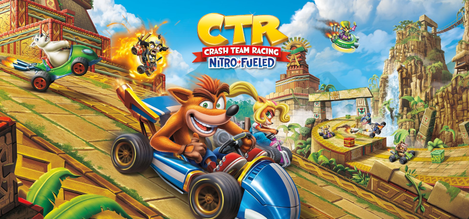

  

# Crash™ Team Racing NF - Dashboard (v0.4.1)

Tablero personal para Crash Team Racing Nitro-Fueled. Lleva la cuenta de tus tiempos de Time Trial y de tus puntajes de Ring Rally, con la pista y el personaje que acabas de usar en el juego.

Abres `CTRNF.exe`, el lanzador enciende la aplicación y el tablero aparece en el navegador. Tus registros se quedan en el equipo, en `%LOCALAPPDATA%\CTRNF\data`, y siguen ahí cuando actualizas. Si hay una versión nueva en las Releases de este repositorio, el lanzador te avisa; la descarga y la instalación las haces tú.

## Time Trial

Eliges la pista que acabas de correr, registras el tiempo y lo guardas. El formato es minutos, segundos y centésimas, por ejemplo `1:25:03`.

A la derecha queda el top 10 de esa pista: puesto, skin, tiempo, fecha y la diferencia con tu mejor marca. El primer puesto va con borde dorado. Abajo, en la misma vista, están los tiempos de los fantasmas del juego para compararlos con lo que acabas de hacer.

Para la pista en curso también ves cuántas veces la registraste, cuánto mejoraste desde el primer tiempo y qué tan parecidos son entre sí tus intentos.

## Ring Rally

El mismo gesto, ahora con puntaje. Anotas los puntos y el número de vueltas de la carrera. El top 10 de la pista ordena de mayor a menor y señala cuándo ese intento fue tu mejor marca, o por cuántos puntos se quedó atrás.

Cuando una skin llega a los puntos que le faltaban, el tablero te lo dice antes de seguir.

## Álbum de skins

El álbum junta las skins por personaje y por rareza: Basic, Exotic, Legendary y Beenox. Arriba ves cuántas llevas desbloqueadas y el multiplicador global que usa la siguiente carrera, con cualquier personaje.

## Trofeos

Cada trofeo muestra en qué vas, de qué nivel es y cuánto suma al multiplicador. Si ya lo completaste, aparece la fecha.

## Respaldo

En Configuración puedes exportar un ZIP con tus tiempos de Contrarreloj y tus puntajes de Ring Rally. Si la aplicación no encuentra sola el log del juego, desde ahí eliges el archivo. Al importar un respaldo, solo se completa un registro que todavía está vacío.

Cada pista tiene un límite para no guardar un tiempo imposible o un puntaje fuera de rango. Esos límites salen de los récords mundiales del modo glitchless publicados en [crashteamranking.com](https://crashteamranking.com/), con un margen del 5 %. Se actualizaron el 31 de octubre de 2026.

Crash Team Racing Nitro-Fueled es una marca de Activision. Este tablero es un proyecto de fans y no está asociado al juego.
