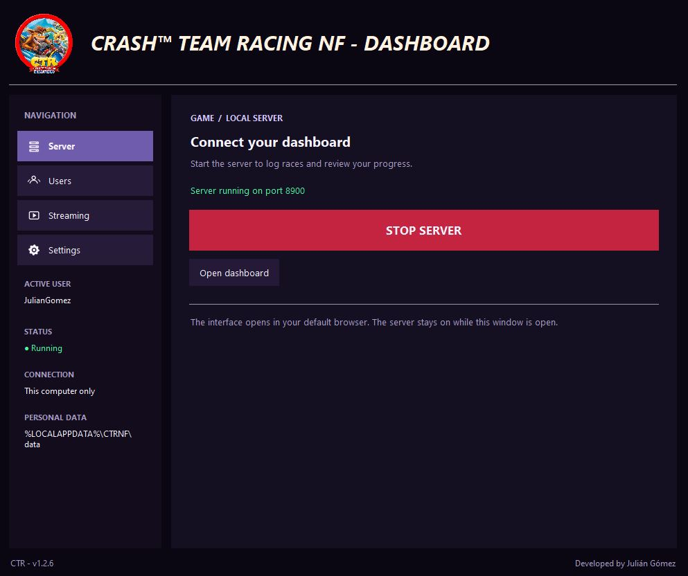
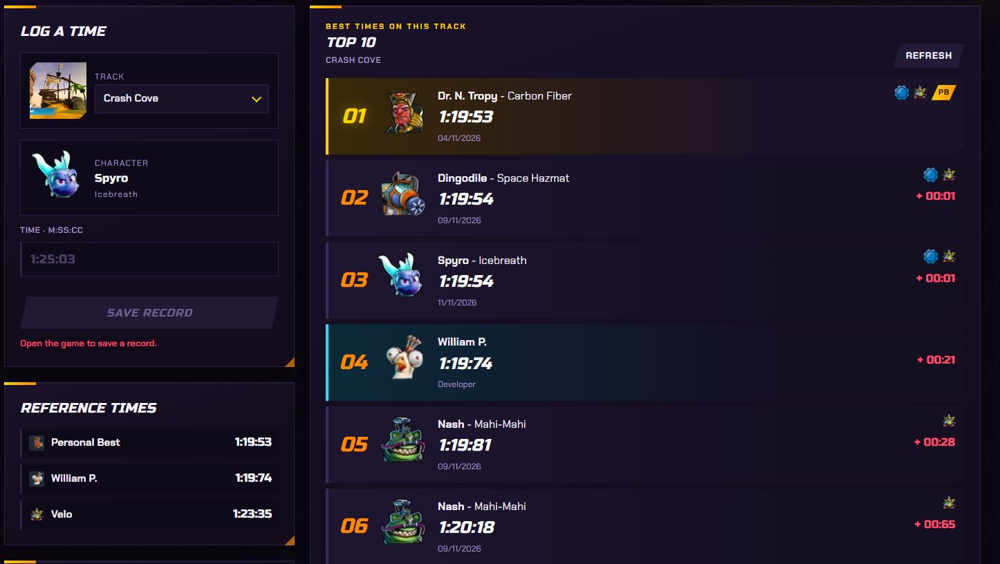
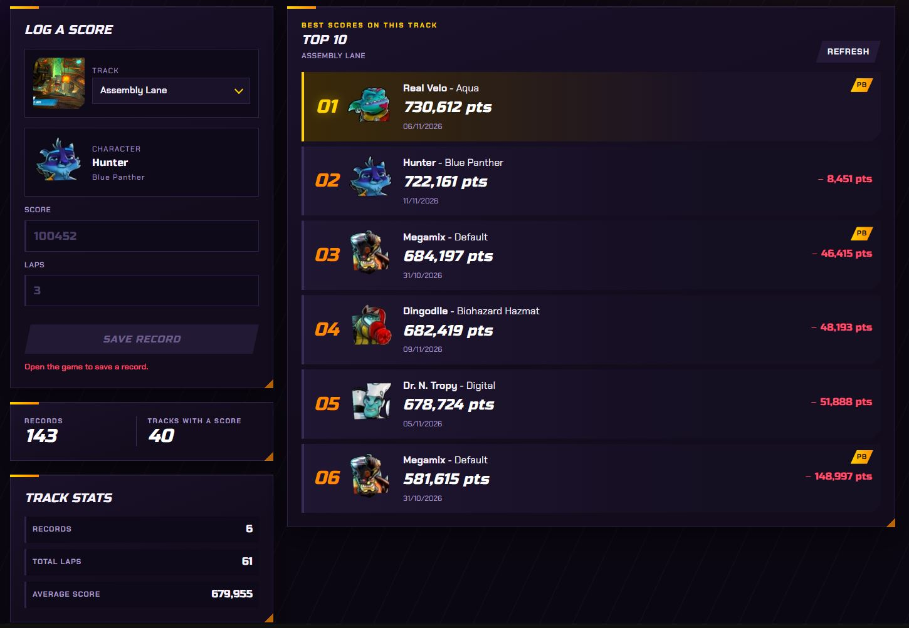
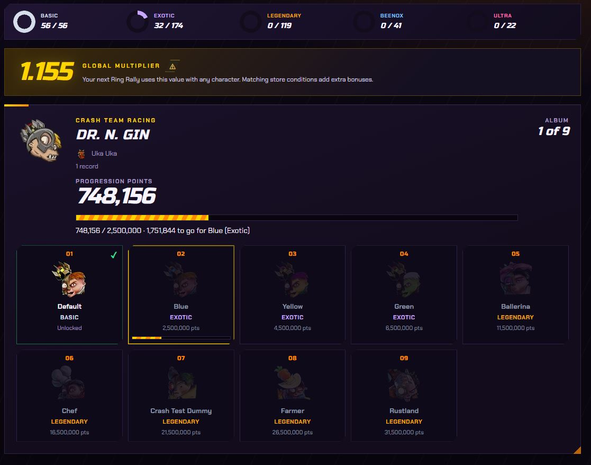
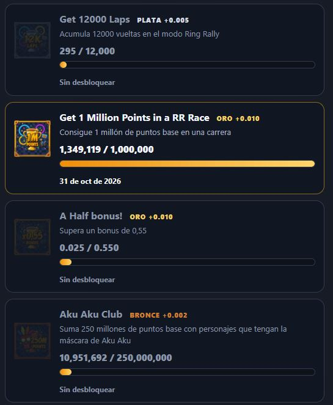
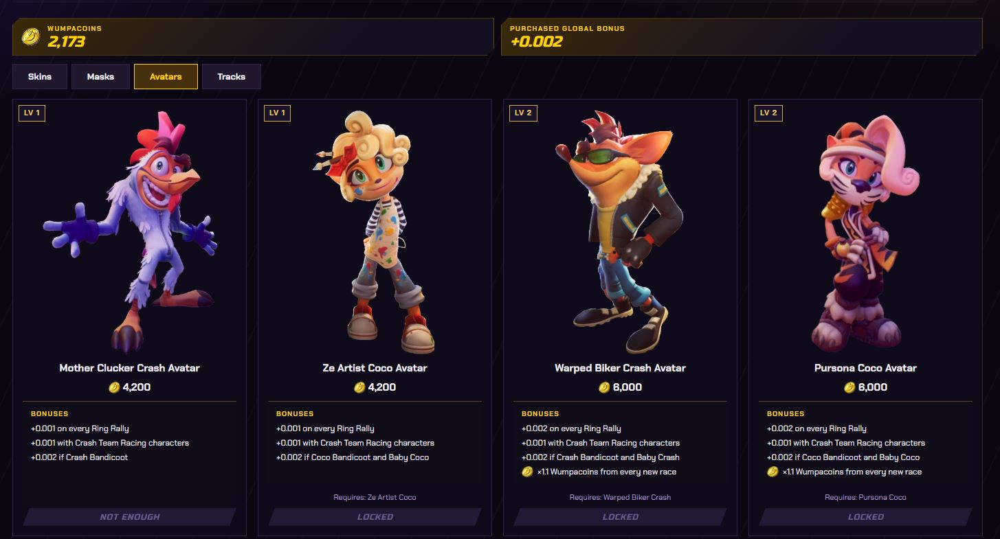
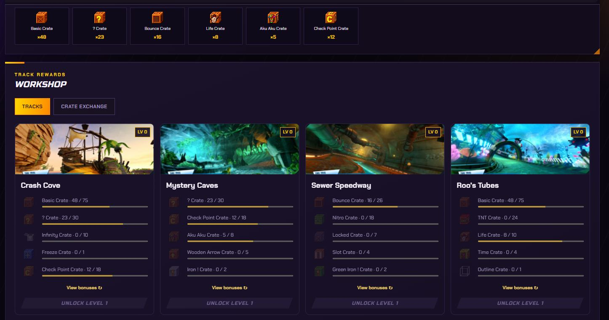
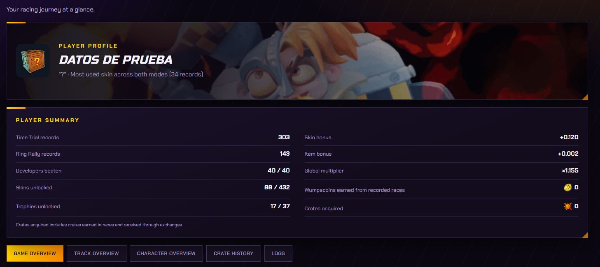
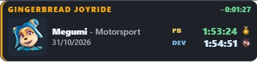

# Crash™ Team Racing NF - Dashboard (v1.5.1)

A personal dashboard for Crash Team Racing Nitro-Fueled, built for the native port by [Ryu7w7](https://github.com/Ryu7w7/OCTR-NitroFueled-PC).

## Before the first launch

* It is strongly recommended to start the game from the port before opening the executable. That creates the log file the executable reads.
* The executable may not find the log on its own. If that happens, choose the file from the executable by browsing to the installed port.
* Open `CTRNF.exe`. The launcher starts the app and the dashboard opens in the browser. Your records stay on the computer, in `%LOCALAPPDATA%\CTRNF\data`, and they remain there when you update. If a newer release exists, the launcher offers to download it and replace `CTRNF.exe` for you. Your records are not touched.

## Users and backups

Open **Users** in the launcher to create or select a local user before starting the server. Each user has a separate race history, Store wallet, and Workshop inventory. Stop the server before switching users.

When upgrading from a version without users, create or select an empty user and choose **Assign existing data to selected user**. Confirm the assignment to copy and verify the existing race and wallet files. The original files remain in `%LOCALAPPDATA%\CTRNF\data` as a backup; the selected user's working files are under `profiles/<user ID>` in that folder.

Stop the server, then in Settings export the active user's data to a ZIP containing a folder named for that user. On another computer, use **Users → Import user from backup** to restore a current ZIP with the same user ID. Older ZIP backups without a user ID can be imported into a selected user through Settings. Imports protect existing records; stop the server first.

## Time Trial

Choose the track you just ran, enter the time, and save it. The format is minutes, seconds, and hundredths, for example `1:25:03`.

The top 10 for that track sits on the right: rank, skin, time, date, and the gap to your best. The developer time occupies a position in the top 10 when it qualifies; otherwise it appears separately below it. First place has a gold edge. The game's ghost times are also shown for comparison.

## Ring Rally

The same action, now with a score. Enter the points and the lap count. The track top 10 sorts from highest to lowest and marks when that attempt was your best, or how many points it fell short.

Track stats show the number of records, total laps, and average base score for the selected track.

## Skin album

The Album also tracks CTR Tokens. New Time Trial and Ring Rally records can award a token matching the track's color. Completing a color adds a 0.200 Ring Rally bonus on matching tracks; collecting all 40 makes that bonus global. The bonus applies to subsequent races. Token unlocks are recorded alongside the race and included in user backups.

The album groups skins by character and by rarity: Basic, Exotic, Legendary, Beenox, and Ultra. At the top you see how many you have unlocked and the global multiplier the next race uses, with any character.

## Trophies

Each trophy shows your progress, its tier, and how much it adds to the multiplier. A completed trophy shows the date.

## Store

The store opens with 5,000 Wumpacoins. That amount is the first row of a new wallet and is not added again. Races you already saved stay as they are and do not pay coins. From this version on, each saved Time Trial or Ring Rally pays the amount set for that track. Ring Rally pays more. Friday, Saturday, and Sunday pay double.

Each new record also has an independent 16.67% chance of finding a Golden Wumpa, awarding 200 extra Wumpacoins. This roll is independent of CTR Tokens and previous races.

Purchased items add their flat bonus to the Skin Album multiplier and the store's purchased bonus total. A conditional bonus applies only on the next Ring Rally when the race matches it: a Crash Team Racing character, a mask, or that exact track. The store catalog is maintained in `data/store/store.json` and preserves item IDs used by the wallet.

## Workshop

New Time Trial and Ring Rally records award crate boxes after the race summary. Time Trial awards one box; Ring Rally awards one to three based on laps, with no boxes below five laps. Each box reveals a crate type and quantity. Historic records are not converted into crates. After opening the boxes, the dashboard stays on the current game mode.

Workshop shows the shared inventory, its total crate count and each track's level 1 requirements. Flip a track card to see its current level and bonus. Confirm the manual unlock to spend its required crates and receive a +0.020 multiplier bonus for future Ring Rally records on that track. Mod tracks can award Time Trial boxes but have no Ring Rally unlock. Under **Crate Exchange**, select the crate you want to receive and choose which crate to spend. Rarer crates can yield up to five more common crates each. You can repeat the selected recipe as many times as your inventory allows. Available recipes appear first. Select **Exchange**, choose the quantity, and confirm to complete the trade. Infinity is a regular crate. Crate inventory and unlocks belong to the selected user and are included in backups.

## Profile

The profile brings your progress together: your most-used skin across both game modes, recorded runs, developers beaten, unlocked skins, and trophies. Choose Game Overview, Track Overview, Character Overview, or Logs. Logs displays one selected mode at a time, newest first in pages of 50, with track, character, skin, result, Wumpacoins and date; Ring Rally also shows the multiplier. Game Overview groups results by game. Its Time Trial total sums track personal bests and developer times when all tracks have them, and shows the corresponding comparison and reference icons when applicable. Its Ring Rally total sums the available track personal bests, runs, score after bonuses, and laps, with a weighted average base score. Mod tracks are excluded from Ring Rally. Track Overview shows personal bests and runs for each mode, developer comparisons in Time Trial, and average base score, score after bonuses, and laps in Ring Rally. Click a column heading to sort the list.

Crate History shows the total acquired and the current inventory for each crate. Click a column heading to sort ascending or descending.

Select a track to expand the selected mode's progress chart and top five; select it again or use Close to collapse them. The chart shows the best personal record reached on each date; the Time Trial chart highlights the area faster than the developer time. The top five includes the developer when the time qualifies. Character Overview groups all skins by character, with total, Time Trial and Ring Rally runs, score after bonuses, and laps. Select a character for a sortable breakdown by track.

## OBS overlays

## Backup

In Settings you can export a ZIP with your Time Trial times, your Ring Rally scores, and your Wumpacoin wallet and Workshop inventory. On startup the program tries to find the game log. If it does not appear, you choose it once and that path stays on the computer; you can change it if you move the game. Importing a backup only fills a record that is still empty.

Every track has a limit so an impossible time or an out-of-range score is not saved. Those limits come from the glitchless world records published on [crashteamranking.com](https://crashteamranking.com/), with a 5% margin. They were updated on October 31, 2026.

Crash Team Racing Nitro-Fueled is an Activision trademark. This dashboard is a fan project and is not associated with the game.

## Building from source

On Windows, install Python and PyInstaller, then run `py -3 -m PyInstaller --noconfirm --clean CTRNF.spec`. The executable is written to `dist/CTRNF.exe`. The game and Workshop catalogs are versioned application data; profile histories, wallets and crate inventories are excluded from Git.
