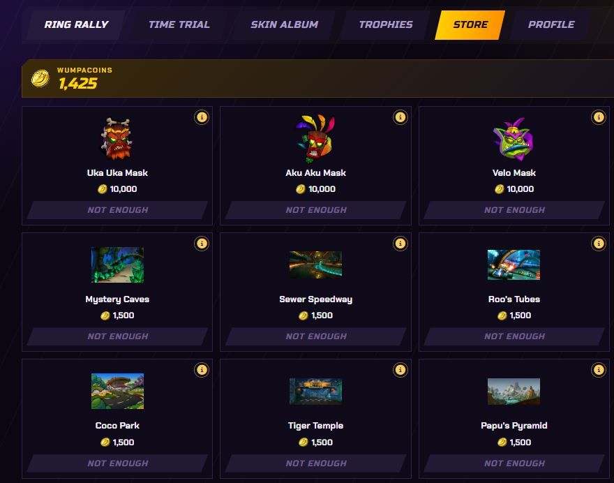
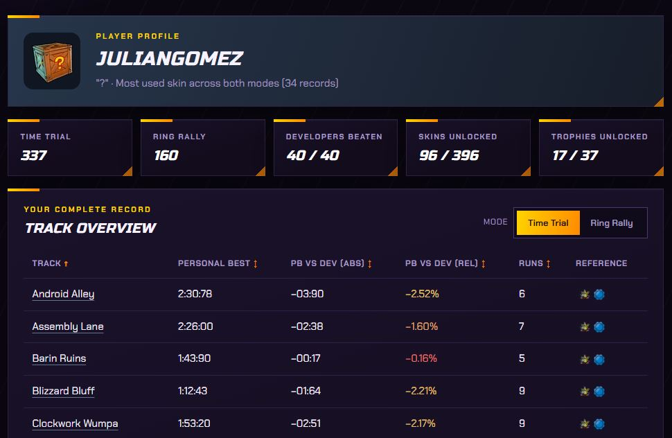

# Crash™ Team Racing NF - Dashboard (v1.2.5)

A personal dashboard for Crash Team Racing Nitro-Fueled, built for the native port by [Ryu7w7](https://github.com/Ryu7w7/OCTR-NitroFueled-PC).

## Before the first launch

* It is strongly recommended to start the game from the port before opening the executable. That creates the log file the executable reads.
* The executable may not find the log on its own. If that happens, choose the file from the executable by browsing to the installed port.
* Open `CTRNF.exe`. The launcher starts the app and the dashboard opens in the browser. Your records stay on the computer, in `%LOCALAPPDATA%\CTRNF\data`, and they remain there when you update. If a newer release exists, the launcher offers to download it and replace `CTRNF.exe` for you. Your records are not touched.

## Users and backups

Open **Users** in the launcher to create or select a local user before starting the server. Each user has a separate race history and Store wallet. Stop the server before switching users.

When upgrading from a version without users, create or select an empty user and choose **Assign existing data to selected user**. Confirm the assignment to copy and verify the existing race and wallet files. The original files remain in `%LOCALAPPDATA%\CTRNF\data` as a backup; the selected user's working files are under `profiles/<user ID>` in that folder.

Stop the server, then in Settings export the active user's data to a ZIP containing a folder named for that user. On another computer, use **Users → Import user from backup** to restore a current ZIP with the same user ID. Older ZIP backups without a user ID can be imported into a selected user through Settings. Imports protect existing records; stop the server first.

## Time Trial

Choose the track you just ran, enter the time, and save it. The format is minutes, seconds, and hundredths, for example `1:25:03`.

The top 10 for that track sits on the right: rank, skin, time, date, and the gap to your best. The developer time occupies a position in the top 10 when it qualifies; otherwise it appears separately below it. First place has a gold edge. The game's ghost times are also shown for comparison.

For the current track you also see your number of records, average time, improvement since the first time, and how close your attempts are to each other.

## Ring Rally

The same action, now with a score. Enter the points and the lap count. The track top 10 sorts from highest to lowest and marks when that attempt was your best, or how many points it fell short.

Track stats show the number of records, total laps, and average base score for the selected track.

## Skin album

The album groups skins by character and by rarity: Basic, Exotic, Legendary, Beenox, and Ultra. At the top you see how many you have unlocked and the global multiplier the next race uses, with any character.

## Trophies

Each trophy shows your progress, its tier, and how much it adds to the multiplier. A completed trophy shows the date.

## Store

The store opens with 5,000 Wumpacoins. That amount is the first row of a new wallet and is not added again. Races you already saved stay as they are and do not pay coins. From this version on, each saved Time Trial or Ring Rally pays the amount set for that track. Ring Rally pays more. Friday, Saturday, and Sunday pay double.

Purchased items add their flat bonus to the Skin Album multiplier and the store's purchased bonus total. A conditional bonus applies only on the next Ring Rally when the race matches it: a Crash Team Racing character, a mask, or that exact track. The store catalog is maintained in `data/store/store.json` and preserves item IDs used by the wallet.

## Profile

The profile brings your progress together: your most-used skin across both game modes, recorded runs, developers beaten, unlocked skins, and trophies. Switch the track overview between Time Trial and Ring Rally. Time Trial shows your personal best, absolute and relative differences against the developer, runs, and icons for beaten Velo and developer times. Ring Rally shows your personal best, runs, average base score, and total laps; mod tracks are hidden. Click a column heading to sort the list.

Select a track to expand its Time Trial and Ring Rally progress charts; select it again or use Close to collapse them. The Time Trial chart also highlights the area faster than the developer time.

## OBS overlays

## Backup

In Settings you can export a ZIP with your Time Trial times, your Ring Rally scores, and your Wumpacoin wallet. On startup the program tries to find the game log. If it does not appear, you choose it once and that path stays on the computer; you can change it if you move the game. Importing a backup only fills a record that is still empty.

Every track has a limit so an impossible time or an out-of-range score is not saved. Those limits come from the glitchless world records published on [crashteamranking.com](https://crashteamranking.com/), with a 5% margin. They were updated on October 31, 2026.

Crash Team Racing Nitro-Fueled is an Activision trademark. This dashboard is a fan project and is not associated with the game.
